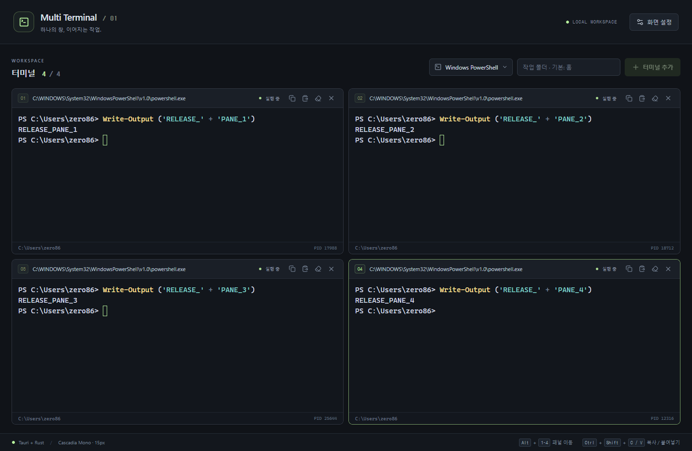

# Multi Terminal

> **한 창에서 최대 4개의 터미널을 사용하는 Windows 전용 데스크톱 앱**
>
> 프론트엔드 개발 서버, 백엔드, 테스트, Git 작업을 나란히 열고 작업하기 위한 멀티 터미널입니다.


---

## 화면 미리보기



> 배포용 실행 파일에서 PowerShell 세션 4개를 실행한 화면입니다. 각 패널은 독립적인 PTY와 셸 프로세스를 사용합니다.

---

## 무엇을 해 주는가

여러 터미널 창을 번갈아 확인하는 대신, 하나의 창에 작업을 나누어 배치합니다.

| 패널     | 사용 예시                 |
| -------- | ------------------------- |
| 터미널 1 | 프론트엔드 개발 서버 실행 |
| 터미널 2 | 백엔드 개발 서버 실행     |
| 터미널 3 | 테스트 실행과 로그 확인   |
| 터미널 4 | Git 명령과 기타 CLI 작업  |

위 구성은 활용 예시입니다. 셸과 작업 폴더를 선택해 패널을 추가하고 명령을 직접 실행합니다. 현재 버전은 프로젝트별 명령 자동 실행이나 작업 공간 복원 기능을 제공하지 않습니다.

### 사용 대상

- 여러 개발 서버와 CLI를 동시에 사용하는 Windows 개발자
- PowerShell, CMD, WSL 작업을 한 화면에서 확인하고 싶은 사용자
- 한글 입력과 글꼴 설정을 갖춘 단순한 4분할 터미널이 필요한 사용자

**지원 대상은 Windows입니다.** macOS·Linux 빌드와 배포는 현재 지원 범위에 포함하지 않습니다.

---

## 주요 기능

- **최대 4개의 독립 PTY** — 패널마다 별도 셸 프로세스, 작업 폴더, 입력·출력을 유지합니다. React UI와 Rust 백엔드 양쪽에서 개수를 제한합니다.
- **자동 분할과 크기 조절** — 1개는 전체 화면, 2개는 좌우, 3개는 상단 2개·하단 1개, 4개는 2×2로 배치합니다. 경계선을 드래그하거나 키보드로 크기를 조절할 수 있습니다.
- **Windows 셸 선택** — Windows PowerShell, PowerShell 7, Command Prompt, WSL을 선택할 수 있습니다.
- **글꼴과 화면 설정** — 설치된 글꼴 선택, 글자 크기, 줄 간격, 스크롤 기록, 커서 깜빡임을 변경하고 자동 저장합니다.
- **한글 입력·출력** — xterm.js의 IME 조합 처리, Unicode 문자 폭, UTF-8 바이트 스트림을 사용합니다.
- **복사·붙여넣기** — 패널 버튼과 단축키로 Windows 클립보드의 텍스트를 복사하거나 붙여넣습니다.
- **세션 종료와 재시작** — 패널을 닫으면 셸과 하위 프로세스를 종료합니다. 자연 종료한 패널은 출력을 남기고 다시 시작할 수 있습니다.
- **대량 출력 처리** — 화면 처리 속도에 맞춰 출력 스트림의 흐름을 제어합니다.

---

## 기술 스택

| 구분          | 사용 기술                            | 역할                                        |
| ------------- | ------------------------------------ | ------------------------------------------- |
| 데스크톱 앱   | Tauri 2 / WebView2                   | Windows 창과 앱 수명 주기                   |
| 프론트엔드    | React 19 / TypeScript / Vite         | 패널, 설정, 사용자 입력 UI                  |
| 터미널 화면   | xterm.js 6 / Fit / Unicode 11 애드온 | 화면 렌더링, IME, 문자 폭, 행·열 계산       |
| 백엔드        | Rust / portable-pty / ConPTY         | 셸 생성, 입출력, 리사이즈, 종료             |
| 글꼴·클립보드 | fontdb / Tauri Clipboard Manager     | 시스템 글꼴 조회와 네이티브 텍스트 클립보드 |
| 검증          | Vitest / Rust tests / Playwright CDP | 설정 검사와 실제 Windows 앱 통합 검사       |

### 동작 구조

```text
React + TypeScript
└─ xterm.js 터미널 패널 × 최대 4개
                 ↕ Tauri IPC commands / Channel
Rust TerminalManager
└─ portable-pty
   └─ Windows ConPTY + 셸 프로세스 × 최대 4개
```

로컬 앱 내부 통신에는 Tauri IPC를 사용하며, 별도의 Axum 서버를 실행하지 않습니다.

---

## 사전 준비

| 항목          | 요구사항                                                             |
| ------------- | -------------------------------------------------------------------- |
| 운영체제      | Windows 10 1809 이상 / Windows 11, x64 빌드                          |
| WebView       | Microsoft Edge WebView2 Runtime                                      |
| Node.js       | 22.12 이상                                                           |
| Rust          | stable, Windows MSVC 도구 체인                                       |
| C++ 빌드 도구 | Visual Studio Build Tools의 C++ 데스크톱 개발 워크로드와 Windows SDK |
| Git           | 소스 코드 복제에 사용                                                |

Node.js, Rust, C++ 빌드 도구는 **소스에서 개발·빌드할 때** 필요합니다. 빌드된 앱을 실행할 때는 Windows와 WebView2 Runtime이 필요합니다.

### 셸별 준비

| 셸                 | 실행 파일        | 비고                         |
| ------------------ | ---------------- | ---------------------------- |
| Windows PowerShell | `powershell.exe` | 기본 선택                    |
| PowerShell 7       | `pwsh.exe`       | 별도 설치 후 PATH 등록 필요  |
| Command Prompt     | `cmd.exe`        | Windows 기본 제공            |
| WSL                | `wsl.exe`        | WSL과 Linux 배포판 설치 필요 |

셸이 설치되지 않았거나 작업 폴더가 없으면 해당 패널에 오류가 표시됩니다.

---

## 개발 셋업

프로젝트 루트에서 실행합니다.

```powershell
# 1. JavaScript 의존성 설치
npm ci

# 2. Tauri 개발 환경 확인
npx tauri info

# 3. Vite + Rust + Tauri 데스크톱 앱 실행
npm run desktop
```

프론트엔드 화면만 확인하려면:

```powershell
npm run dev
```

브라우저 미리보기에서는 실제 셸이 실행되지 않습니다. PTY 입출력은 Tauri 데스크톱 앱에서 확인하세요.

---

## 사용법

1. 앱을 실행하면 Windows PowerShell 터미널 하나가 열립니다.
2. 상단에서 새 터미널의 셸과 작업 폴더를 선택합니다. 작업 폴더에는 절대 경로를 입력하며, 비워 두면 사용자 홈 폴더를 사용합니다.
3. **터미널 추가**를 눌러 최대 4개까지 추가합니다.
4. 패널 사이의 경계선을 드래그해 화면 비율을 조절합니다.
5. **화면 설정**에서 글꼴과 글자 크기 등을 변경합니다. 실행 중인 셸을 재시작하지 않고 모든 패널에 적용됩니다.
6. 복사할 텍스트를 드래그한 뒤 복사 버튼이나 단축키를 사용합니다.
7. 작업을 마치면 패널의 닫기 버튼으로 해당 세션을 종료합니다.

여러 줄을 붙여넣으면 해당 셸의 동작에 따라 명령이 실행될 수 있습니다.

### 단축키

| 단축키                    | 동작                       |
| ------------------------- | -------------------------- |
| `Ctrl+Shift+T`            | 새 터미널 추가             |
| `Alt+1` ~ `Alt+4`         | 화면 순서에 따라 패널 이동 |
| `Ctrl+Shift+C`            | 선택 영역 복사             |
| `Ctrl+Shift+V`            | 클립보드 붙여넣기          |
| `Ctrl+V` / `Shift+Insert` | 클립보드 붙여넣기          |
| `Ctrl+C`                  | 실행 중인 명령 중단        |
| 경계선 포커스 후 방향키   | 패널 크기 조절             |

---

## 설정

| 항목        | 기본값        | 변경 범위                            |
| ----------- | ------------- | ------------------------------------ |
| 터미널 글꼴 | Cascadia Mono | 설치된 글꼴 선택 또는 이름 직접 입력 |
| 글자 크기   | 15px          | 10~32px                              |
| 줄 간격     | 1.25배        | 1 / 1.1 / 1.25 / 1.4 / 1.6 / 1.8배   |
| 스크롤 기록 | 5,000줄       | 1,000 / 5,000 / 10,000 / 20,000줄    |
| 커서 깜빡임 | 켜짐          | 켜기 / 끄기                          |

설정은 앱 WebView의 `localStorage`에 `multi-terminal.settings.v1` 키로 자동 저장합니다. 별도 설정 파일은 생성하지 않습니다. **기본값 복원**으로 화면 설정을 초기화할 수 있습니다.

한글 글리프는 설치된 한글 글꼴로 보완합니다. 선택한 글꼴이 설치되어 있지 않으면 대체 글꼴로 표시됩니다. 패널 구성, 작업 폴더, 실행 중인 명령과 셸 상태는 저장·복원하지 않습니다.

---

## 빌드와 배포 산출물

```powershell
npx tauri build
```

| 산출물                     | 경로                                                                      |
| -------------------------- | ------------------------------------------------------------------------- |
| 실행 파일                  | `src-tauri/target/release/multi-terminal.exe`                             |
| Windows NSIS 설치 프로그램 | `src-tauri/target/release/bundle/nsis/Multi Terminal_0.1.0_x64-setup.exe` |

현재 설치 프로그램에는 코드 서명이 설정되어 있지 않습니다. 빌드 결과물은 Git 추적에서 제외하며, 이 README에서 GitHub Releases 업로드를 의미하지는 않습니다.

---

## 검증

### 정적 검사와 단위 검사

```powershell
npm run build
npm test
cargo test --manifest-path src-tauri/Cargo.toml --lib -- --test-threads=1
cargo clippy --manifest-path src-tauri/Cargo.toml --all-targets -- -D warnings
```

### 실제 Windows 앱 통합 검사

```powershell
# 개발 앱: WebView2 + Tauri IPC + 실제 ConPTY
npm run test:desktop

# 배포 실행 파일: 먼저 npx tauri build 실행 필요
npm run test:release
```

| 검사               | 확인 내용                                                                                         |
| ------------------ | ------------------------------------------------------------------------------------------------- |
| Vitest             | 설정 기본값, 손상된 값 복구, 범위 제한, 글꼴 대체 처리                                            |
| Rust tests         | 최대 4개 제한, 동시 생성, 한글 입출력, 잘못된 요청, 출력 대기 중 종료                             |
| 데스크톱 통합 검사 | 실제 PTY 4개, 세션 분리, 한글 클립보드·IME, 설정 적용·저장, 리사이즈, 대량 출력, 중단·종료·재시작 |
| 배포 실행 검사     | 번들 자산으로 실행, 개발용 테스트 브리지 제외, 터미널 4개에서 실제 명령 실행                      |

개발 앱 검사는 1420·9223 포트, 배포 실행 검사는 9224 포트를 사용합니다. 해당 포트가 비어 있어야 합니다. 테스트용 디버깅 포트는 검사 프로세스를 실행할 때만 켜집니다. 개발 앱 검사는 클립보드와 화면 설정을 임시 변경한 뒤 원래 값을 복원합니다.

IME 검사는 Chromium의 IME 프로토콜을 사용합니다. 모든 물리 키보드·Windows IME 설정 조합을 검증한 것은 아닙니다. 검사 로그와 스크린샷은 `test-results/`에 생성됩니다.

---

## 프로젝트 구조

```text
multi-terminal/
├── src/
│   ├── App.tsx                 # 패널 배치, 셸 선택, 화면 설정
│   ├── terminal.ts             # xterm, IPC, 입력 큐, 클립보드, 출력 ACK
│   ├── settings.ts             # 설정 저장과 값 검증
│   ├── settings.test.ts        # 설정 단위 검사
│   ├── main.tsx                # React 진입점
│   └── style.css               # 앱 스타일
├── src-tauri/
│   ├── src/
│   │   ├── main.rs             # Windows 앱 진입점
│   │   ├── lib.rs              # IPC 명령, 글꼴 조회, 앱 수명 주기
│   │   └── terminal.rs         # PTY, 셸, 흐름 제어, 종료, Rust tests
│   ├── capabilities/           # Tauri 창·클립보드 권한
│   ├── icons/                  # 앱 아이콘
│   ├── Cargo.toml
│   └── tauri.conf.json
├── scripts/
│   ├── desktop-smoke.mjs       # 개발 앱 통합 검사
│   └── release-smoke.mjs       # 배포 실행 파일 검사
├── docs/images/main.png        # 실제 앱 스크린샷
├── app-icon.svg                # 아이콘 원본
├── package.json
└── README.md
```

---

## 구현과 기여 기록

이 프로젝트의 초기 구현과 README 정리는 **OpenAI Codex**를 사용해 진행했습니다.

| 역할                               | 담당         |
| ---------------------------------- | ------------ |
| 요구사항과 제품 방향 결정          | 사용자       |
| 초기 코드 구현·자동 검사·문서 정리 | OpenAI Codex |

---

## 현재 상태

**Windows용 MVP**입니다. 최대 4개의 로컬 터미널, 화면 설정, 한글 입력, 복사·붙여넣기, 세션 종료·재시작을 구현했습니다.

프로젝트별 작업 공간 저장, 앱 재실행 시 세션 복원, 시작 명령 자동 실행, 전용 SSH/SFTP 관리 기능은 아직 구현하지 않았습니다.

## 라이선스

현재 별도의 라이선스를 지정하지 않았습니다.
